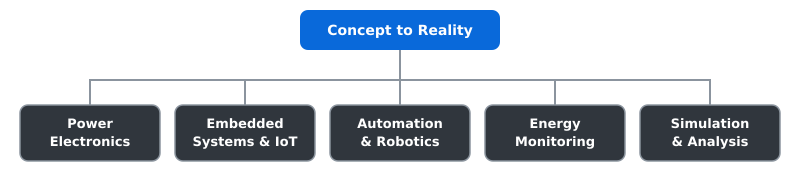
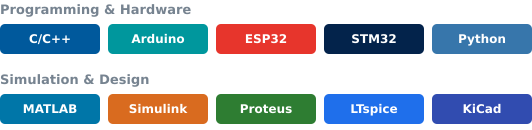

<h1 align="center">Hi, I'm Jewel Rana</h1>

<h3 align="center">Concept to Reality • Creative Engineering • Problem Solving</h3>

  Electrical & Electronic Engineering student at <b>Daffodil International University</b>, Bangladesh. 
  I like turning circuit ideas into working hardware, from simulation to final build.

## Fields I Work In

## Skills & Tools

## GitHub Stats

  
  

## Connect With Me

